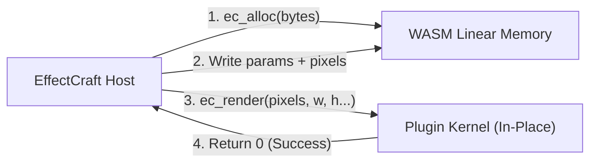

<div align="center">

# ⚡ CraftPlugins

### Production-grade WebAssembly motion design & VFX plugins for [EffectCraft](https://github.com/storytold/effectcraft)

[](https://www.rust-lang.org)
[](https://webassembly.org)
[](#architecture--api-v1)
[](LICENSE)
[](#contributing)

<p align="center">
  <a href="README.md"><b>English</b></a> •
  <a href="README.ru.md"><b>Русский</b></a> •
  <a href="README.zh-CN.md"><b>简体中文</b></a>
</p>

---

</div>

## 🌟 Overview

**CraftPlugins** is an open-source suite of high-performance visual effects and motion design plugins engineered specifically for **EffectCraft** (the modern open-source Rust alternative to Adobe After Effects).

Inspired by industry-standard After Effects plugins (*Deep Glow*, *Quick Chromatic Aberration*, *Sapphire Shake*, *Displacer Pro*), each effect is compiled into a standalone, zero-dependency **WebAssembly (`.wasm`)** binary that runs sandboxed, deterministically, and cross-platform (Linux, macOS, Windows) at native-level speeds.

### ✨ Key Features
- 🚀 **Zero Overhead WASM:** Compiled with `--target wasm32-unknown-unknown`, executing via host-sandboxed WebAssembly with fuel metering and zero native host bloat.
- 🎨 **32-bpc HDR Pipeline:** Native processing of linear premultiplied `f32` RGBA buffers, preserving full dynamic range and highlight details without banding.
- 📦 **One-Click Hot-Loading:** Load `.wasm` files directly into running EffectCraft sessions via `Effect ▸ Load Effect Plug-in…` or drop them into your `Plug-ins` directory.
- 🎛️ **Full Keyframe & Expression Support:** Exposes native host properties (sliders, angles, colors, checkboxes, points, popups) directly to the Effect Controls panel and timeline graph editor.

---

## ⚡ Instant Download (Ready `.wasm` Binaries)

> [!TIP]
> **No Rust or compilation needed for artists!** Simply download the pre-compiled `.wasm` file below and load it directly into EffectCraft.

| Plugin | Architecture | Size | Latest Release | Direct Download |
| :--- | :---: | :---: | :---: | :--- |
| **Craft Glow** | WASM API v1 | `32 KB` | `v1.0.0` | [⬇️ **Download `craft_glow.wasm`**](https://github.com/qwertyonek/craft-plugins/raw/main/dist/craft_glow.wasm) |
| **Craft Chromatic** | WASM API v1 | `37 KB` | `v1.0.0` | [⬇️ **Download `craft_chromatic.wasm`**](https://github.com/qwertyonek/craft-plugins/raw/main/dist/craft_chromatic.wasm) |

---


## 🧩 Plugin Suite

| Plugin | AE Counterpart | Category | Status | Highlights |
| :--- | :--- | :--- | :---: | :--- |
| **`craft-glow`** | *Deep Glow* | `by qwertyonek` | ✅ `Ready` | Physically accurate inverse-square ($1/r^2$) falloff, luminance threshold, chromatic aberration halo, HDR tinting. |
| **`craft-chromatic`** | *Quick Chromatic* | `by qwertyonek` | ✅ `Ready` | Radial (optical lens dispersion) & linear (directional prism) RGB channel split, subpixel bilinear sampling, edge blur. |
| **`craft-camera-shake`** | *Sapphire S_Shake* | `by qwertyonek` | 📋 `Planned` | Procedural multi-frequency Simplex noise, rotational/translational micro-jitter, auto-scale edge padding, motion blur. |
| **`craft-displacer`** | *Displacer Pro* | `by qwertyonek` | 📋 `Planned` | Advanced subpixel displacement mapping, chromatic shift, rotation/scale mapping, anti-aliased coordinates. |
| **`craft-halftone-dither`** | *Retro / Halftone* | `by qwertyonek` | 📋 `Planned` | Matrix ordered dithering (Bayer 4×4 & 8×8), CMYK/RGB halftone screens, retro arcade palettes (GameBoy, CGA, Pico-8). |

---

## 📐 Architecture & API v1

EffectCraft plug-ins adhere to the official **Plug-in API v1** ABI. Plug-ins have **no external imports** and communicate through a shared linear memory buffer:



### Exported Symbols:
* `ec_api_version() -> i32` — Must return `1`.
* `ec_manifest_ptr() -> i32` & `ec_manifest_len() -> i32` — Memory offset & byte length of the UTF-8 JSON manifest.
* `ec_alloc(bytes: i32) -> i32` — Allocates an 8-byte aligned memory buffer for parameter values and pixels.
* `ec_render(pixels, width, height, params, nparams, time, scale) -> i32` — Processes premultiplied RGBA `f32` in-place.

### Pixel Contract:
- Pixels are stored in row-major **Premultiplied RGBA `f32`** (`[r, g, b, a]`).
- Channels: `0.0` .. `1.0` (can exceed `1.0` in 32-bpc HDR compositions).
- Un-premultiply before nonlinear operations: `rgb = c[0..3] / a`, then re-premultiply upon output: `c[0..3] = rgb * a`.

---

## 🚀 Quick Start & Installation

### Option 1: Drop into Plug-ins Folder (Auto-load on startup)
Copy compiled `.wasm` plugins into your platform settings folder:
- **Linux:** `~/.config/effectcraft/Plug-ins/`
- **macOS:** `~/Library/Application Support/EffectCraft/Plug-ins/`
- **Windows:** `%APPDATA%\EffectCraft\Plug-ins\`

### Option 2: Load at Runtime
1. Open **EffectCraft**.
2. Select your layer in the timeline or composition viewer.
3. In the top menu bar, click: **`Effect ▸ Load Effect Plug-in…`**
4. Select your `.wasm` file. The plugin will immediately register in **Effects & Presets** and apply to the active layer!

---

## 🛠️ Building from Source

### Prerequisites
- [Rust toolchain](https://rustup.rs/) (1.85+)
- WebAssembly target:
```bash
rustup target add wasm32-unknown-unknown
```

### Build All Plugins
```bash
# Clone the repository
git clone https://github.com/qwertyonek/craft-plugins.git
cd craft-plugins

# Build all workspace plugins in release mode
cargo build --release --target wasm32-unknown-unknown
```

Compiled `.wasm` artifacts will be located in:
```text
target/wasm32-unknown-unknown/release/*.wasm
```

---

## 🤝 Contributing

Contributions, feature requests, and new plugin ideas are warmly welcome!
1. Fork the Project.
2. Create your Feature Branch (`git checkout -b feat/amazing-plugin`).
3. Commit your Changes (`git commit -m 'feat: add amazing-plugin'`).
4. Push to the Branch (`git push origin feat/amazing-plugin`).
5. Open a Pull Request.

---

## 📄 License

Distributed under the **MIT License**. See [`LICENSE`](LICENSE) for more details.
