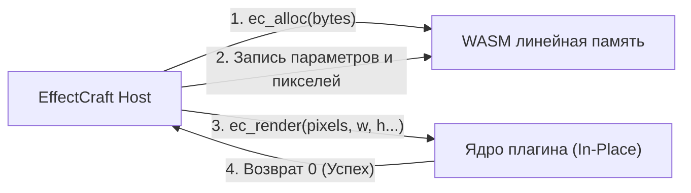

<div align="center">

# ⚡ CraftPlugins

### Профессиональные WebAssembly плагины для моушн-дизайна и VFX в [EffectCraft](https://github.com/storytold/effectcraft)

[](https://www.rust-lang.org)
[](https://webassembly.org)
[](#архитектура-и-api-v1)
[](LICENSE)
[](#участие-в-разработке)

<p align="center">
  <a href="README.md"><b>English</b></a> •
  <a href="README.ru.md"><b>Русский</b></a> •
  <a href="README.zh-CN.md"><b>简体中文</b></a>
</p>

---

</div>

## 🌟 Обзор проекта

**CraftPlugins** — это набор производительных плагинов визуальных эффектов и моушн-дизайна с открытым исходным кодом, созданных специально для **EffectCraft** (современного open-source аналога Adobe After Effects на Rust).

Вдохновленные культовыми плагинами для After Effects (*Deep Glow*, *Quick Chromatic Aberration*, *Sapphire Shake*, *Displacer Pro*), каждый эффект компилируется в автономный **WebAssembly (`.wasm`)** модуль без внешних зависимостей. Они исполняются в изолированной песочнице с замером вычислительного топлива (fuel limit), работают полностью детерминировано и кроссплатформенно (Linux, macOS, Windows) с околонативной скоростью.

### ✨ Ключевые особенности
- 🚀 **Нулевой оверхед (WASM):** Сборка с целевой платформой `--target wasm32-unknown-unknown`, запуск через защищенную песочницу `wasmi` без раздувания зависимостей хоста.
- 🎨 **32-bpc HDR пайплайн:** Прямая обработка линейных premultiplied `f32` RGBA буферов, сохраняющая полный динамический диапазон и детали ярких светов без постеризации.
- 📦 **Горячая загрузка в 1 клик:** Загружайте файлы `.wasm` прямо в запущенную сессию EffectCraft через меню `Effect ▸ Load Effect Plug-in…` или поместите их в системную папку `Plug-ins`.
- 🎛️ **Кейфреймы и выражения:** Плагины предоставляют нативные свойства (слайдеры, углы, цвета, чекбоксы, точки, выпадающие списки) в панель Effect Controls и графический редактор таймлайна.

---

## 🧩 Набор плагинов

| Плагин | Аналог в AE | Категория | Статус | Особенности |
| :--- | :--- | :--- | :---: | :--- |
| **`craft-glow`** | *Deep Glow* | `Stylize` / `Glow` | 🔨 `В разработке` | Физически корректное затухание по обратному квадрату ($1/r^2$), порог яркости, хроматическая аберрация в ореоле, HDR тонирование. |
| **`craft-chromatic`** | *Quick Chromatic* | `Distort` / `Stylize` | 📋 `Запланирован` | Радиальное и линейное разделение RGB каналов, оптическая дисперсия линзы, размытие каналов, виньетирование по краям. |
| **`craft-camera-shake`** | *Sapphire S_Shake* | `Distort` / `Transform` | 📋 `Запланирован` | Процедурный многочастотный шум Симплекс, микро-дрожание и вращение, авто-зум для предотвращения черных краев, motion blur. |
| **`craft-displacer`** | *Displacer Pro* | `Distort` | 📋 `Запланирован` | Продвинутая карта смещения с субпиксельным сглаживанием, хроматический сдвиг, управление вращением и масштабом. |
| **`craft-halftone-dither`** | *Retro / Halftone* | `Stylize` / `Retro` | 📋 `Запланирован` | Матричный упорядоченный дизеринг (Bayer 4×4 и 8×8), растровые точки CMYK/RGB, палитры ретро-консолей (GameBoy, CGA, Pico-8). |

---

## 📐 Архитектура и API v1

Плагины EffectCraft строго следуют официальной спецификации **Plug-in API v1**. Модули **не содержат внешних импортов** и взаимодействуют через общую линейную память:



### Экспортируемые C-функции:
* `ec_api_version() -> i32` — Обязана возвращать `1`.
* `ec_manifest_ptr() -> i32` и `ec_manifest_len() -> i32` — Указатель и длина UTF-8 JSON манифеста в памяти.
* `ec_alloc(bytes: i32) -> i32` — Выделяет 8-байтово выровненный буфер для параметров и пикселей.
* `ec_render(pixels, width, height, params, nparams, time, scale) -> i32` — Обрабатывает кадр premultiplied RGBA `f32` in-place.

### Формат пикселей:
- Пиксели представлены как **Premultiplied RGBA `f32`** (`[r, g, b, a]`).
- Диапазон каналов: от `0.0` до `1.0` (может превышать `1.0` в 32-bpc HDR композициях).
- Для нелинейных расчетов пиксели разворачиваются (`rgb = c[0..3] / a`), а при сохранении снова домножаются на альфу (`c[0..3] = rgb * a`).

---

## 🚀 Быстрый старт и установка

### Способ 1: Поместить в папку Plug-ins (Автозагрузка)
Скопируйте скомпилированные `.wasm` файлы в папку настроек EffectCraft:
- **Linux:** `~/.config/effectcraft/Plug-ins/`
- **macOS:** `~/Library/Application Support/EffectCraft/Plug-ins/`
- **Windows:** `%APPDATA%\EffectCraft\Plug-ins\`

### Способ 2: Загрузка во время работы
1. Запустите **EffectCraft**.
2. Выберите слой на таймлайне или во вьюере.
3. В верхнем меню выберите: **`Effect ▸ Load Effect Plug-in…`**
4. Укажите файл `.wasm`. Эффект мгновенно появится в панели **Effects & Presets** и применится к активному слою!

---

## 🛠️ Сборка из исходников

### Требования
- [Rust toolchain](https://rustup.rs/) (1.85+)
- Установленный таргет WebAssembly:
```bash
rustup target add wasm32-unknown-unknown
```

### Сборка всех плагинов
```bash
# Клонирование репозитория
git clone https://github.com/qwertyonek/craft-plugins.git
cd craft-plugins

# Сборка всех плагинов в release-режиме
cargo build --release --target wasm32-unknown-unknown
```

Готовые файлы `.wasm` появятся в папке:
```text
target/wasm32-unknown-unknown/release/*.wasm
```

---

## 🤝 Участие в разработке

Мы рады пул-реквестам, идеям новых эффектов и предложениям по оптимизации!
1. Сделайте форк репозитория.
2. Создайте ветку фичи (`git checkout -b feat/amazing-plugin`).
3. Зафиксируйте изменения (`git commit -m 'feat: add amazing-plugin'`).
4. Отправьте ветку на GitHub (`git push origin feat/amazing-plugin`).
5. Откройте Pull Request.

---

## 📄 Лицензия

Распространяется под лицензией **MIT License**. Подробнее см. в файле [`LICENSE`](LICENSE).
