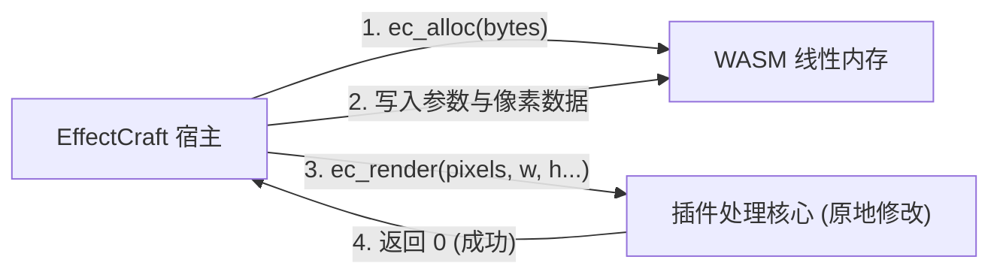

<div align="center">

# ⚡ CraftPlugins

### 适用于 [EffectCraft](https://github.com/storytold/effectcraft) 的专业级 WebAssembly 动态设计与视觉特效插件库

[](https://www.rust-lang.org)
[](https://webassembly.org)
[](#架构与-api-v1)
[](LICENSE)
[](#参与贡献)

<p align="center">
  <a href="README.md"><b>English</b></a> •
  <a href="README.ru.md"><b>Русский</b></a> •
  <a href="README.zh-CN.md"><b>简体中文</b></a>
</p>

---

</div>

## 🌟 项目概述

**CraftPlugins** 是一套专为 **EffectCraft**（基于 Rust 开发的现代化开源 Adobe After Effects 替代品）量身定制的高性能视觉特效与动态设计开源插件库。

本系列插件灵感源自 AE 行业知名标杆（*Deep Glow*、*Quick Chromatic Aberration*、*Sapphire Shake*、*Displacer Pro* 等）。每个特效均编译为独立的零依赖 **WebAssembly (`.wasm`)** 二进制文件，在带有燃料监控（fuel limit）的安全沙盒中运行，具备确定性、跨平台特性（Linux、macOS、Windows）以及接近原生的执行性能。

### ✨ 核心特性
- 🚀 **零额外开销 (WASM)：** 采用 `--target wasm32-unknown-unknown` 构建，通过宿主 `wasmi` 沙盒高效运行，无多余依赖和体积膨胀。
- 🎨 **32-bpc HDR 浮点管线：** 原生处理线性预乘（Premultiplied）`f32` RGBA 缓冲区，完美保留高动态范围高光细节，彻底告别色彩断层。
- 📦 **一键热加载：** 支持在 EffectCraft 运行过程中直接通过 `Effect ▸ Load Effect Plug-in…` 加载 `.wasm` 文件，或放置到系统 `Plug-ins` 目录自启。
- 🎛️ **完整的关键帧与表达式支持：** 无缝向 Effect Controls 面板和时间线曲线编辑器暴露原生参数（滑块、角度、颜色、复选框、点坐标、下拉菜单）。

---

## ⚡ 预编译插件一键下载（无需安装 Rust）

> [!TIP]
> **动态设计师与后期制作人员无需手动编译！** 直接下载下方预编译好的 `.wasm` 文件，即可直接在 EffectCraft 中加载使用。

| 插件名称 | 运行架构 | 体积 | 最新版本 | 直接下载 |
| :--- | :---: | :---: | :---: | :--- |
| **Craft Glow** | WASM API v1 | `32 KB` | `v1.0.0` | [⬇️ **下载 `craft_glow.wasm`**](https://github.com/qwertyonek/craft-plugins/raw/main/dist/craft_glow.wasm) |
| **Craft Chromatic** | WASM API v1 | `37 KB` | `v1.0.0` | [⬇️ **下载 `craft_chromatic.wasm`**](https://github.com/qwertyonek/craft-plugins/raw/main/dist/craft_chromatic.wasm) |
| **Craft Camera Shake** | WASM API v1 | `40 KB` | `v1.0.0` | [⬇️ **下载 `craft_camera_shake.wasm`**](https://github.com/qwertyonek/craft-plugins/raw/main/dist/craft_camera_shake.wasm) |
| **Craft Displacer** | WASM API v1 | `42 KB` | `v1.0.0` | [⬇️ **下载 `craft_displacer.wasm`**](https://github.com/qwertyonek/craft-plugins/raw/main/dist/craft_displacer.wasm) |

---


## 🧩 插件套件

| 插件名称 | 对应 AE 插件 | 分类 | 状态 | 功能亮点 |
| :--- | :--- | :--- | :---: | :--- |
| **`craft-glow`** | *Deep Glow* | `by qwertyonek` | ✅ `已完成` | 物理精确的平方反比衰减 ($1/r^2$)、辉光阈值截断、光晕色差边缘分离、HDR 色调映射。 |
| **`craft-chromatic`** | *Quick Chromatic* | `by qwertyonek` | ✅ `已完成` | 径向（光学透镜色散）与线性（棱镜）RGB 色彩分离、次像素双线性插值采样、边缘模糊。 |
| **`craft-camera-shake`** | *Sapphire S_Shake* | `by qwertyonek` | ✅ `已完成` | 程序化多频连续梯度噪声、次像素平移与旋转抖动、边缘自适应防黑边、运动模糊。 |
| **`craft-displacer`** | *Displacer Pro* | `by qwertyonek` | ✅ `已完成` | 高级次像素置换映射、玻璃折射法线计算、流体湍流、冲击波纹、色散色差偏移。 |
| **`craft-halftone-dither`** | *Retro / Halftone* | `by qwertyonek` | 📋 `计划中` | 矩阵有序抖动算法 (Bayer 4×4 与 8×8)、CMYK/RGB 半色调网点、复古游戏调色板 (GameBoy, CGA, Pico-8)。 |

---

## 📐 架构与 API v1

EffectCraft 插件严格遵循官方 **Plug-in API v1** 规范。插件模块**不包含任何外部导入 (No imports)**，通过共享线性内存与宿主通信：



### 导出的 C ABI 函数：
* `ec_api_version() -> i32` — 必须返回 `1`。
* `ec_manifest_ptr() -> i32` 与 `ec_manifest_len() -> i32` — 内存中 UTF-8 JSON 清单的指针与字节长度。
* `ec_alloc(bytes: i32) -> i32` — 分配 8 字节对齐的参数与像素缓冲区。
* `ec_render(pixels, width, height, params, nparams, time, scale) -> i32` — 原地（In-Place）处理预乘 RGBA `f32` 帧缓冲区。

### 像素格式规范：
- 像素数据按行优先格式排布为 **Premultiplied RGBA `f32`** (`[r, g, b, a]`)。
- 通道值域通常为 `0.0` 至 `1.0`（在 32-bpc HDR 项目中可超过 `1.0`）。
- 进行非线性运算前需逆预乘：`rgb = c[0..3] / a`，运算完成后写回前重新预乘：`c[0..3] = rgb * a`。

---

## 🚀 快速上手与安装

### 方式 1：放入插件目录（启动时自动载入）
将编译生成的 `.wasm` 文件复制到对应操作系统的插件文件夹：
- **Linux:** `~/.config/effectcraft/Plug-ins/`
- **macOS:** `~/Library/Application Support/EffectCraft/Plug-ins/`
- **Windows:** `%APPDATA%\EffectCraft\Plug-ins\`

### 方式 2：运行时动态加载
1. 启动 **EffectCraft**。
2. 在时间线或预览窗口中选中目标图层。
3. 点击顶部菜单栏：**`Effect ▸ Load Effect Plug-in…`**
4. 选择对应的 `.wasm` 文件。该特效将立即注册到 **Effects & Presets** 面板并附加到当前图层！

---

## 🛠️ 从源码构建

### 环境要求
- [Rust 编译器](https://rustup.rs/) (1.85+)
- WebAssembly 交叉编译目标：
```bash
rustup target add wasm32-unknown-unknown
```

### 构建所有插件
```bash
# 克隆仓库
git clone https://github.com/qwertyonek/craft-plugins.git
cd craft-plugins

# 以 release 模式编译所有插件
cargo build --release --target wasm32-unknown-unknown
```

构建生成的 `.wasm` 位于：
```text
target/wasm32-unknown-unknown/release/*.wasm
```

---

## 🤝 参与贡献

热烈欢迎提交 Pull Request、报告 Issue 或提出新的特效创意！
1. Fork 本项目。
2. 创建特性分支 (`git checkout -b feat/amazing-plugin`)。
3. 提交修改 (`git commit -m 'feat: add amazing-plugin'`).
4. 推送到远程分支 (`git push origin feat/amazing-plugin`).
5. 发起 Pull Request。

---

## 📄 开源许可证

本项目基于 **MIT License** 开源。详情参见 [`LICENSE`](LICENSE) 文件。
